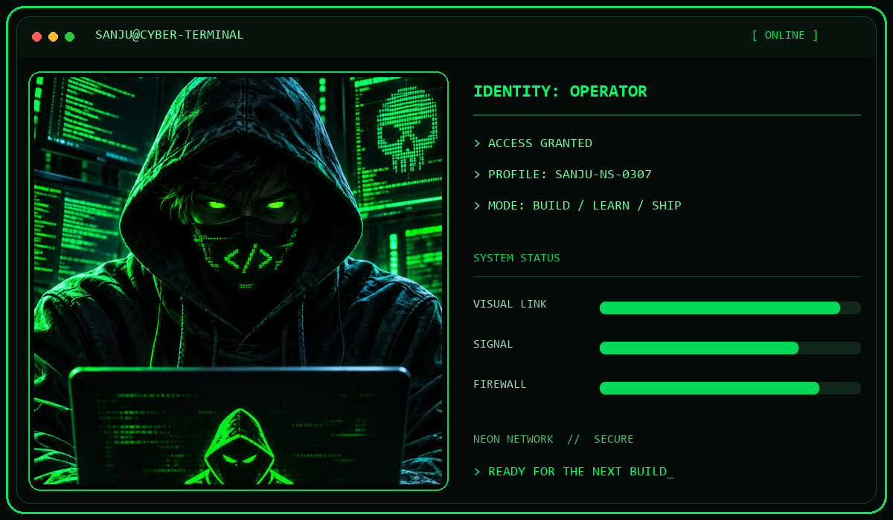
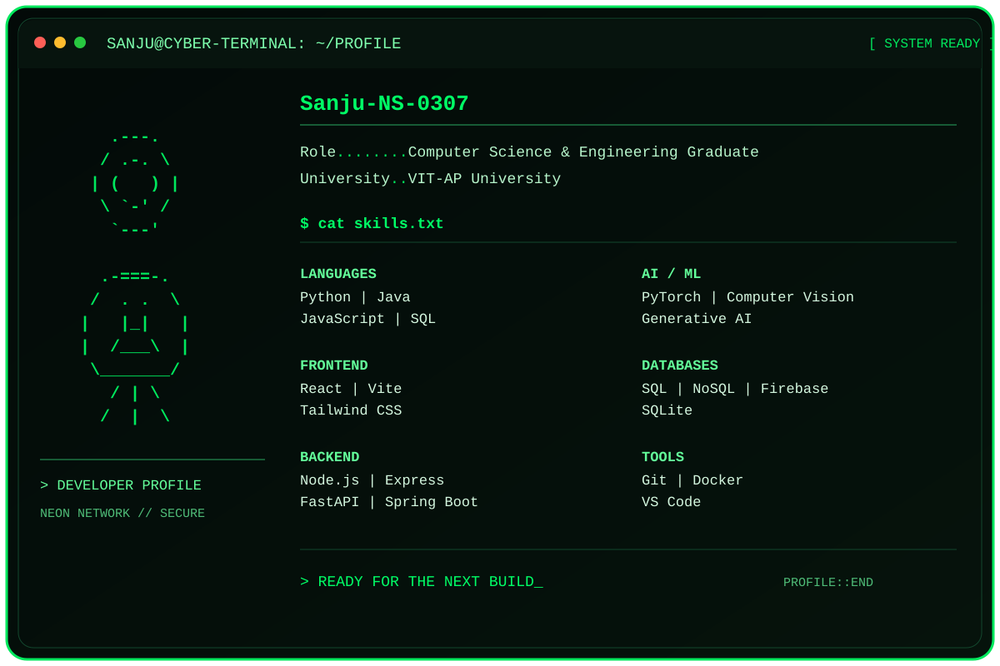
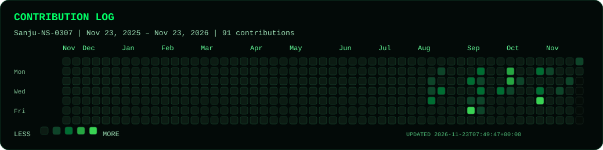

# Sanju-NS-0307

`Terminal profile` | `Developer toolkit` | `GitHub activity`

  

## Developer profile

  

## Contribution activity

The calendar below shows contribution activity from GitHub's public profile page. A daily refresh workflow is configured in GitHub Actions; its first successful run has not yet been verified.

  

<code>sanju@github:~$ echo "Thanks for stopping by."</code>

